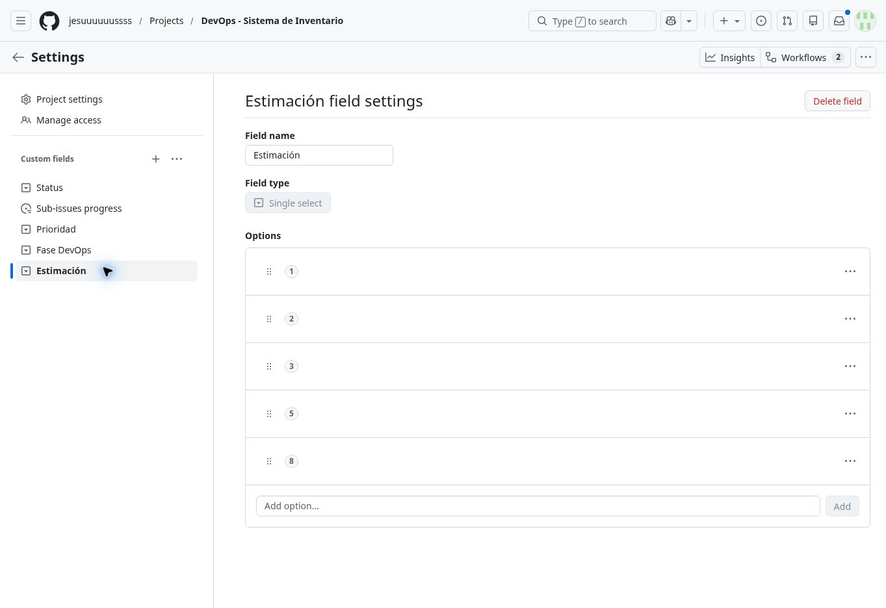
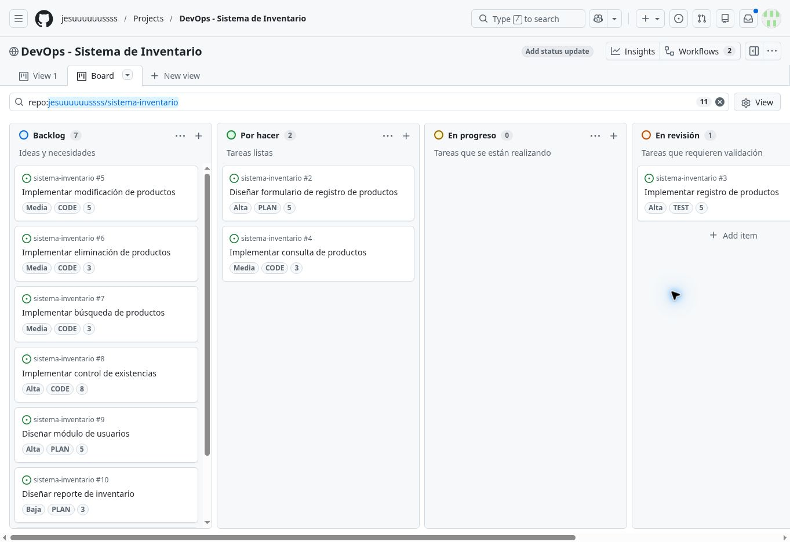
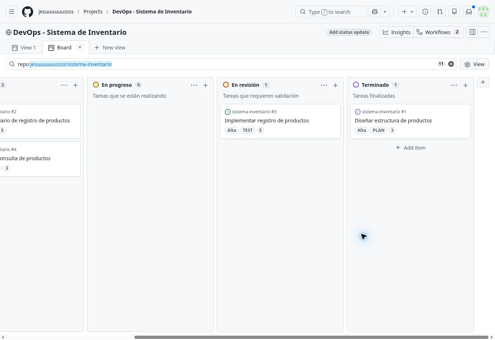
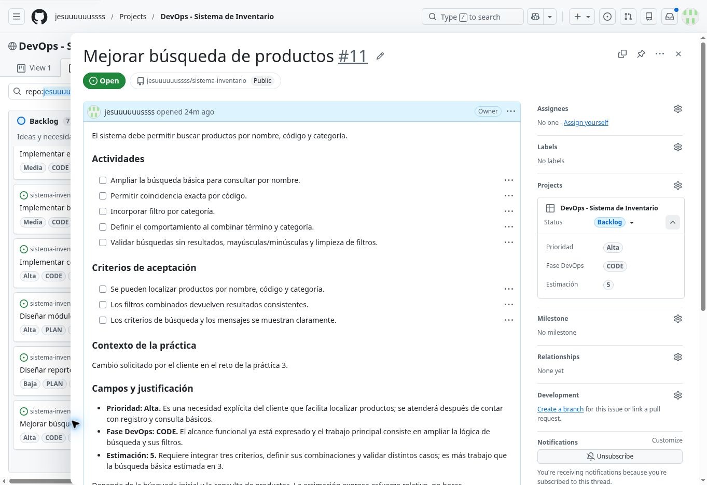
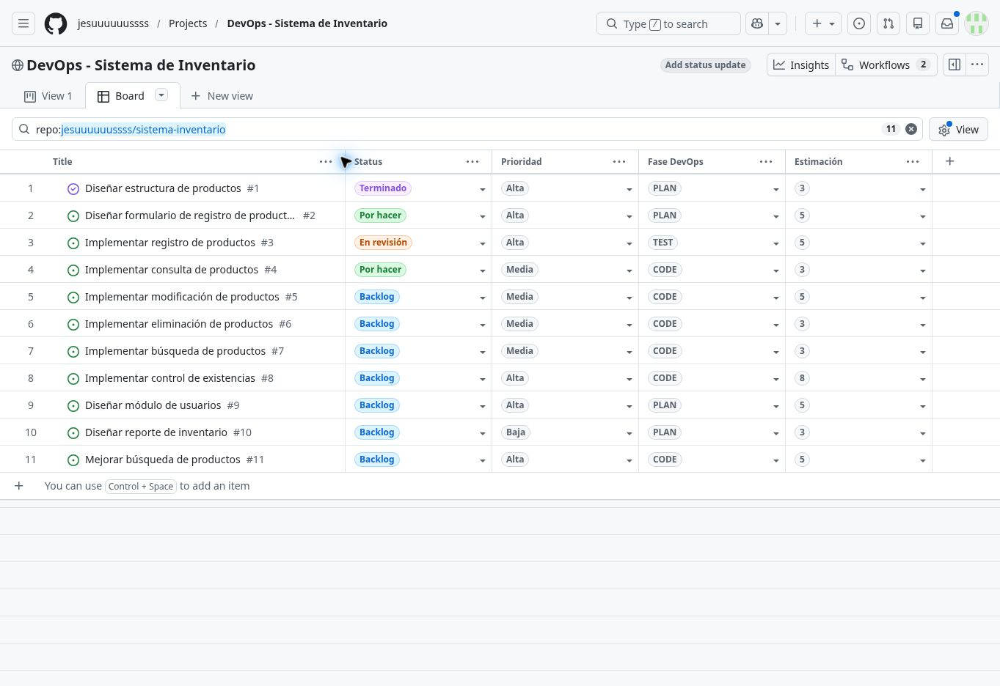

# Evidencias de las prácticas de GitHub Projects

Capturas reales de la configuración realizada en la cuenta **jesuuuuuussss**.

| Archivo | Evidencia |
| --- | --- |
| github-inventario-campos.jpg | Settings con Prioridad, Fase DevOps y Estimación; escala 1, 2, 3, 5 y 8. |
| github-inventario-board-izquierda.jpg | Vista Board con Backlog, Por hacer, En progreso y el inicio de En revisión. |
| github-inventario-board-derecha.jpg | Continuación del mismo Board con En progreso, En revisión y Terminado. |
| github-inventario-mejora-busqueda.jpg | Issue #11 con prioridad Alta, fase CODE, estimación 5 y la justificación del reto. |
| github-inventario-planificacion.jpg | Verificación temporal en formato de tabla de las 11 Issues y sus campos. La vista guardada permanece como Board. |

El tablero tiene desplazamiento horizontal. Las dos capturas del Board se complementan para mostrar sus cinco columnas, en este orden: **Backlog → Por hacer → En progreso → En revisión → Terminado**.

## Campos personalizados

## Board sección izquierda

## Board sección derecha

## Nueva Issue del reto

## Verificación de las once Issues

[Regresar a las respuestas de las tres prácticas](../../README.md)
